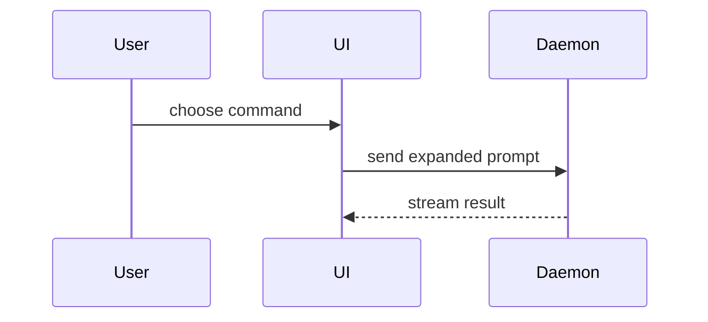

# Visuals for the What section

Pick the smallest view that makes the key point clear. One view is the usual
count. Keep only the calls, files, props, states, and boundaries that the
reviewer needs, and place each view next to the short text it supports.

## Diff sketch

Use a `diff` block to show a change inside a shape that already exists. Match
the shape of the sketch to the topic.

A file-layout change:

```diff
 src/
 ├── commands/
+│   └── show-me.ts       # expands the slash command
 ├── sessions/
-└── transport.ts
+└── transport/
+    ├── client.ts
+    └── stream.ts
```

A call-tree change:

```diff
 submitForm
   createSession
     persistPrompt
+    expandSkillMention
     launchAgent
```

A state or control-flow change:

```diff
 on(save)
-  write content
+  if content is unchanged
+    return cached result
+  write new content
+  invalidate cache
```

A component change uses the same form on a component tree.

## Tree

Use a tree when most of the shape is new.

File responsibility or a broad refactor, as a shallow file tree:

```text
src/
├── commands/       # parses user actions
├── sessions/       # owns session state
└── transport/      # sends API requests
```

Control flow at runtime, as a call tree:

```text
submitForm
  createSession
    persistPrompt
    launchAgent
  navigateToSession
```

UI structure, as a component tree with the state and module boundaries that
matter:

```text
<SessionPage> (apps/example/src/routes/session.tsx)
  useSessionEvents()
  <SessionToolbar>
    <RunSkillButton> (packages/ui)
```

## Diagram

Use Mermaid for component interaction, control flow, or data flow. GitHub
renders a `mermaid` block as a diagram.



## Pseudocode

Use pseudocode for logic or an algorithm.

```text
on(save)
  if content is unchanged
    return cached result
  write new content
  return fresh result
```
